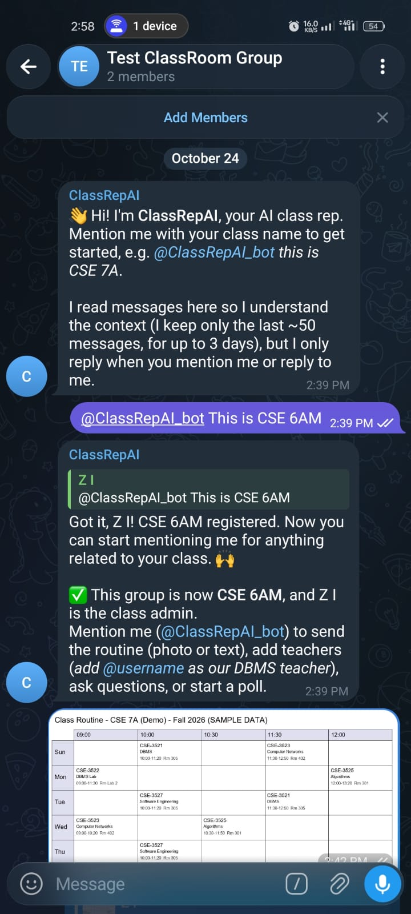
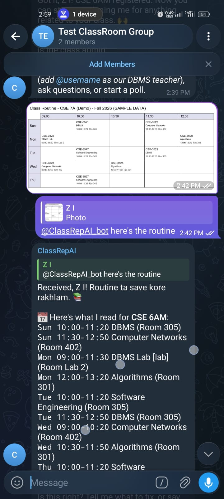
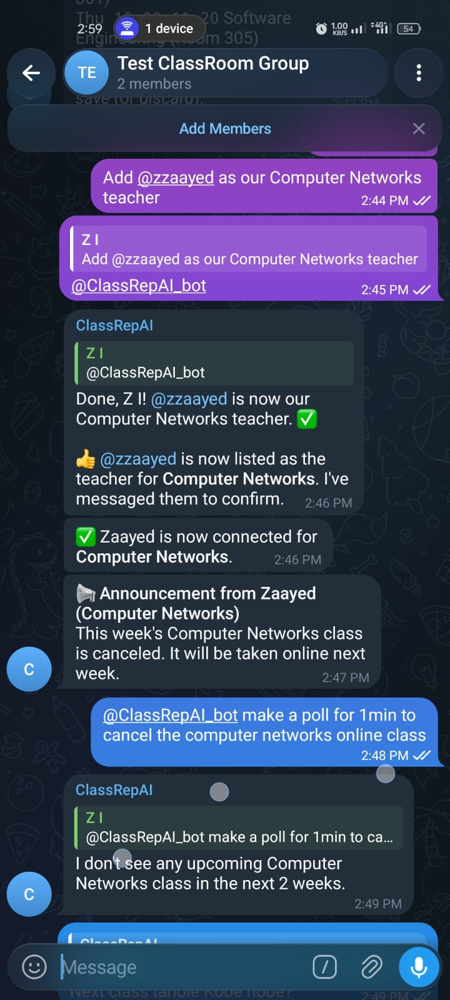
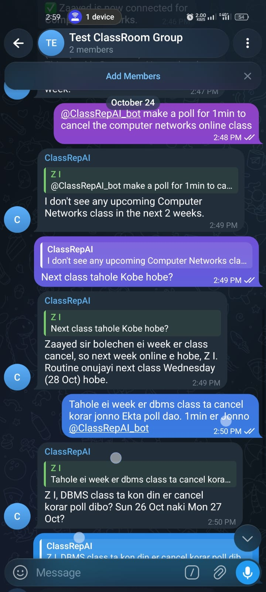
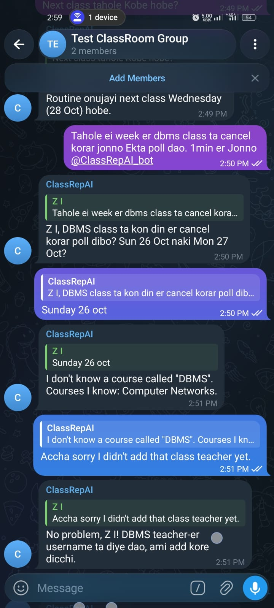
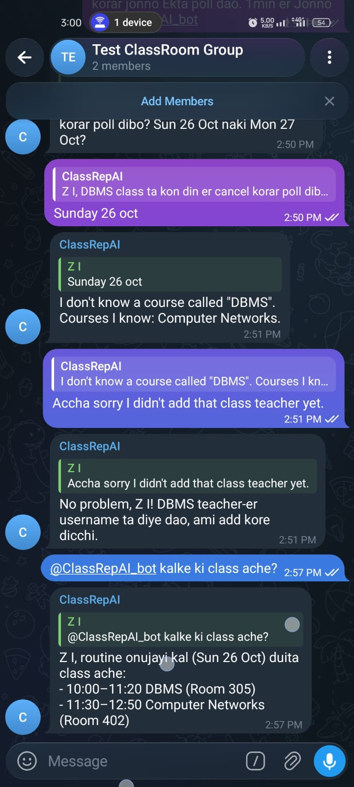
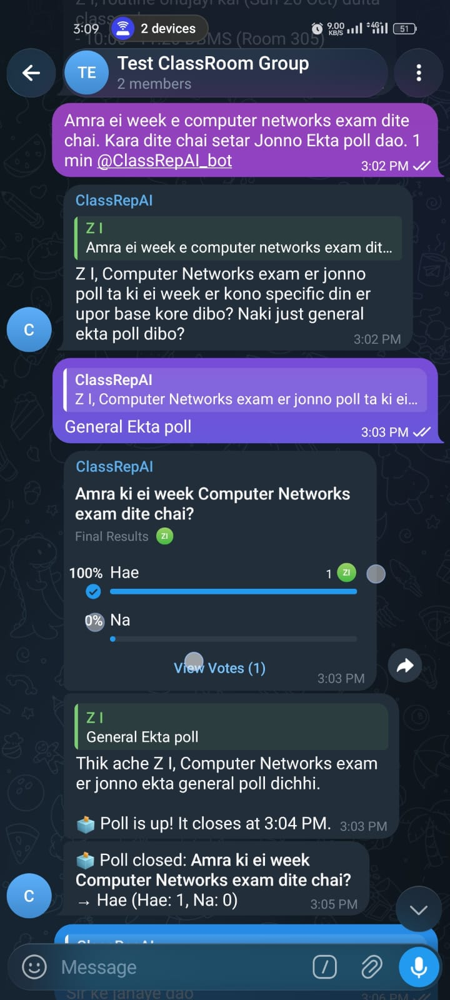

# ClassRepAI

**ClassRepAI** is an intelligent AI class representative, powered by Gemma 4, that lives in your class's
Telegram group. It follows the conversation and understands Bangla, Banglish and English. It reads the
class routine straight from a photo and answers questions from what it actually knows. When students ask,
it runs polls and politely negotiates with teachers on the class's behalf. Every decision goes into its
memory, so it can recall weeks later what the class agreed and what the teacher said.

> 💬 **Anyone can try the AI right now:** search for [@ClassRepAI_bot](https://t.me/ClassRepAI_bot) on Telegram and add it to your group.

## 🚀 Try it now: [@ClassRepAI_bot](https://t.me/ClassRepAI_bot)

The bot is live and hosted, so judges can try it in their own Telegram group. No setup or code needed.

1. Create a Telegram group and add **@ClassRepAI_bot**.
2. Introduce your class: `@ClassRepAI_bot this is CSE 7A`
3. Send a routine photo (e.g. [`docs/sample_routine.png`](docs/sample_routine.png)) with the caption
   `@ClassRepAI_bot here's our routine`. Check what it read, then reply `save it` (or tell it what to fix).
4. Ask anything about your classes: `@ClassRepAI_bot kal ki class ache?` or `@ClassRepAI_bot when is DBMS lab?`
5. Start a vote: `@ClassRepAI_bot make a 1 minute poll: makeup class on Sunday or Tuesday?`
6. **Teacher flow (needs a second Telegram account with a username):**
   - In the group: `@ClassRepAI_bot add @teacher_username as our DBMS teacher`
   - From the teacher account: open @ClassRepAI_bot, press **Start**, and reply `yes`.
   - In the group: `@ClassRepAI_bot ask sir to cancel the next DBMS class, 2 minute poll` → vote.
     When it passes, the teacher gets a polite request and can simply reply, e.g. `ok, cancel it but read chapter 5`.
   - From the teacher account: `Tell CSE 7A the quiz is moved to Thursday 10am`, then `send it`.
7. Ask what was decided: `@ClassRepAI_bot what have we decided so far?`

Tips: the bot reads the group for context but only replies when you **mention it or reply to it**.
It runs on a free tier, so the very first reply after a long idle may take ~30–60 s.

## Screenshots / demo

| | | |
|---|---|---|
| <br>Setting up a class in plain language | <br>Reading the routine from a photo | <br>Teacher linked, announcement relayed |
| <br>Uses the teacher's announcement as context and asks which day | <br>Honest about what it doesn't know yet | <br>"kalke ki class ache?" answered with rooms |
| <br>Banglish request → poll → closed with the result | <br>Teacher side: confirms in private chat and dictates an announcement | |

## The problem

In a university class, information moves through messy group chats and one overworked person: the CR
(class representative). Students ask "kal ki class ache?" again and again, the routine is an old photo
buried somewhere in the chat, class-cancellation requests are chaotic with no clear proof of what the
class actually wants, decisions get lost in scrollback, and teachers have no reliable way to reach the
whole class when the CR is busy or absent.

Today students deal with it by scrolling, asking the CR, and screenshots. The CR deals with it by
answering the same questions all day and messaging teachers on the class's behalf.

## The solution

ClassRepAI sits in the class's Telegram group. It quietly follows the conversation for context, but only
speaks when someone mentions it. Students can send it the routine as a photo, ask about classes in plain
Bangla/Banglish/English, and ask it to run a poll — for example to request a class cancellation. When a
cancellation poll passes, ClassRepAI messages the teacher politely, understands the teacher's
plain-language answer, and tells the class. Teachers can message it privately to post announcements.
Every decision (poll results, teacher decisions, announcements) is saved to the class's memory, so the bot
can answer "what did we decide?" weeks later.

## How it works

- **Model:** [Gemma 4](https://ai.google.dev/gemma) (open-weight, by Google), called through the Google AI
  Studio API. Model ID: set in `GEMMA_MODEL` (see `scripts/check_model.py`).
  Gemma reads routine photos (multimodal) and runs the "brain": one call per message that returns a natural
  reply plus at most one action from a fixed list.
- **Tech stack:** Python 3.11, python-telegram-bot, FastAPI, SQLAlchemy (PostgreSQL on Neon / SQLite
  locally), Render (Docker), cron-job.org.
- **Datasets:** none. All demo data is invented (`scripts/demo_data.py`, `docs/sample_routine.png`).

```
Telegram ──▶ FastAPI /webhook ──▶ log message to a short rolling window (no AI)
                                    │
                    mentioned / replied to / private chat? ── no ──▶ stay quiet
                                    │ yes
                 context: routine, sessions, class memory, open items, last 30 messages
                                    │
                         Gemma 4 ──▶ { reply, action }
                                    │
         code validates + checks permissions + runs the action (poll, save routine, ...)
                                    │
                               PostgreSQL ◀── /tick every minute (close polls, teacher deadlines)
```

Design choices:
- **The model decides *what*, code decides *how*.** Gemma can only choose from a closed list of actions;
  code validates every field and checks who is allowed to do it. Chat history is treated as context, never
  as instructions.
- **Nothing time-based lives in memory.** Poll closing and teacher deadlines are rows in a `jobs` table,
  so a restart doesn't lose them.
- **Human confirmation before publishing model output** (routine save, teacher announcements), given in
  plain language.
- **Privacy:** the bot keeps only the last ~50 messages per chat for up to 3 days, as context.

## How to run it

1. Clone the repo.
2. In [@BotFather](https://t.me/BotFather): create a bot, then `/setprivacy` → **Disable** (so it can read
   group messages for context).
3. `cp .env.example .env` and fill in the values.
4. `python -m venv .venv` and `.venv/Scripts/pip install -r requirements.txt` (Windows) or
   `.venv/bin/pip install -r requirements.txt`.
5. `python scripts/check_model.py` — lists the Gemma models your key can use; put the right one in `GEMMA_MODEL`.
6. `python -m app.run_polling` — runs locally with long polling and SQLite.
7. Optional: `python scripts/seed_demo.py <group_chat_id>` fills a set-up group with the demo routine.
8. Tests: `pytest`.

**Deploy:** create a free Neon Postgres database and a Render web service from this repo (Docker,
`render.yaml`). Set the env vars in Render, with `PUBLIC_BASE_URL` = the Render URL (the app registers the
webhook on startup). On cron-job.org, call `GET <PUBLIC_BASE_URL>/tick?secret=<APP_SECRET>` every minute.

## What's not done yet

- Telegram only (no Messenger/WhatsApp).
- Students can only talk to the bot in the group; private chat for students is planned.
- Teachers must press Start in the bot's private chat once before it can reach them.
- The bot only knows the last ~50 messages of chat context.
- Routine reading can misread dense or blurry tables; the user confirms before saving.
- Class memory: the last 30 decisions go into each prompt; no search beyond that yet.
- If a course has two classes on the same day, a cancellation poll targets the first one.

## Credits

- [Gemma 4](https://ai.google.dev/gemma) by Google, via [google-genai](https://github.com/googleapis/python-genai)
- [python-telegram-bot](https://python-telegram-bot.org/), [FastAPI](https://fastapi.tiangolo.com/),
  [SQLAlchemy](https://www.sqlalchemy.org/), [Pydantic](https://docs.pydantic.dev/), [Pillow](https://python-pillow.org/)
- Hosting: [Render](https://render.com/), [Neon](https://neon.tech/), [cron-job.org](https://cron-job.org/)
- Built with [Claude Code](https://claude.com/claude-code) as a coding assistant.
